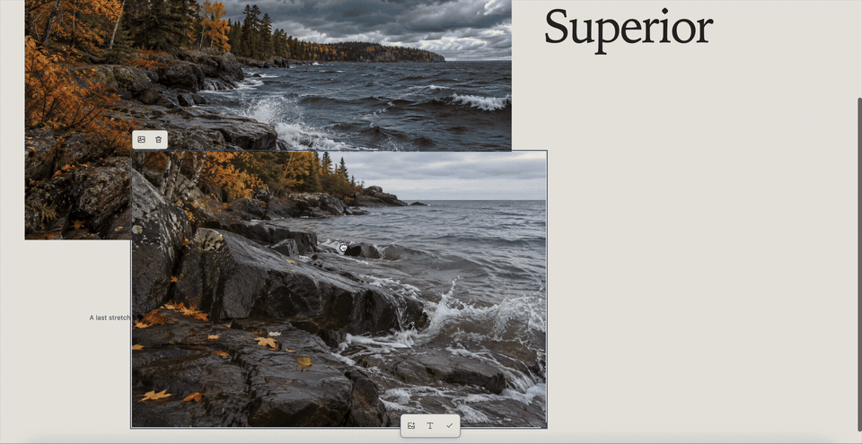
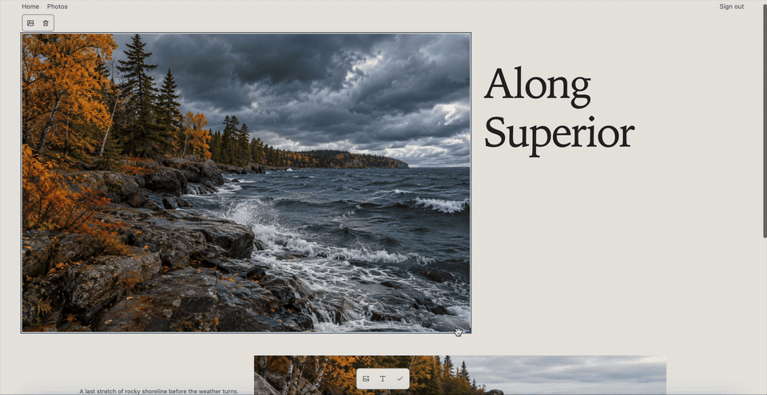
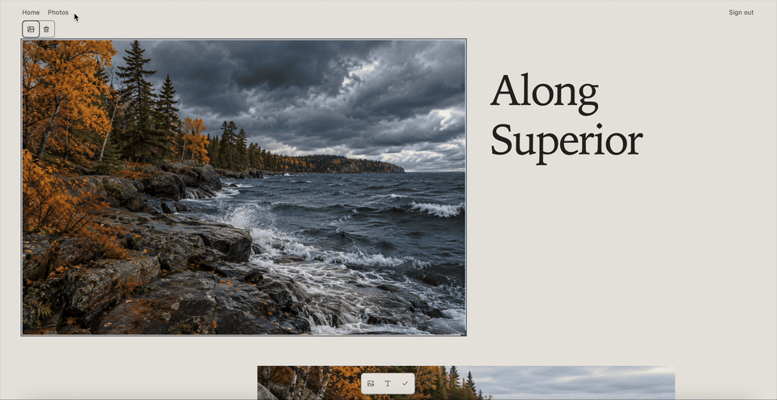
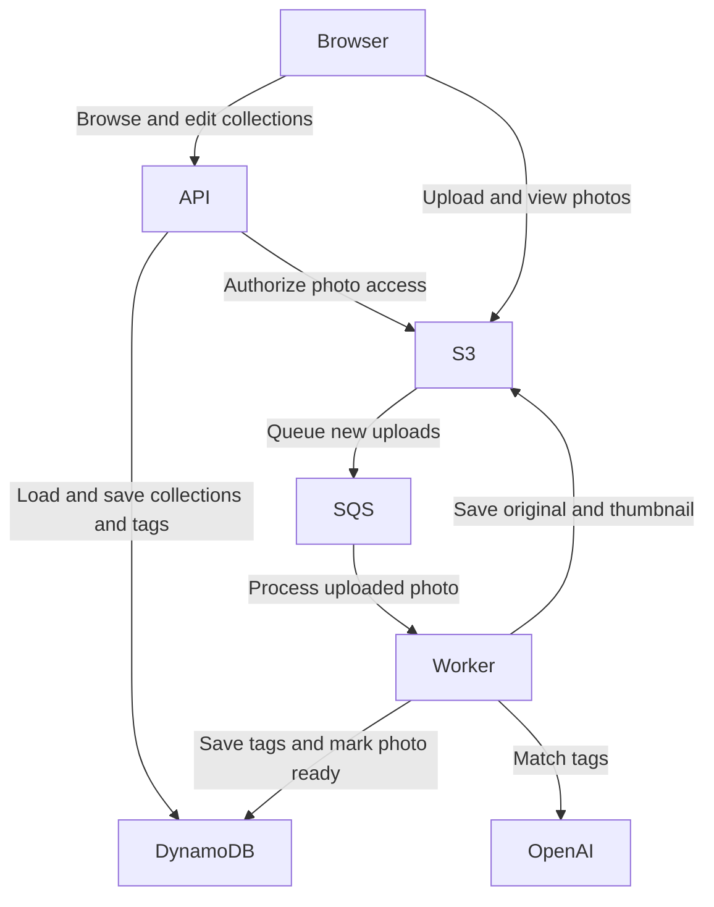

# Portfolio

My personal portfolio site for uploading and organizing photos with tags in a private library. It supports canvas-like editing to create and publish collections from trips.

## Editing

### Moving photos

### Resizing photos

### Selecting photos

## Architecture

React and TypeScript frontend with a Go API and Worker running on AWS Lambda. Google sign-in restricts editing to the owner, and Terraform manages the infrastructure.

